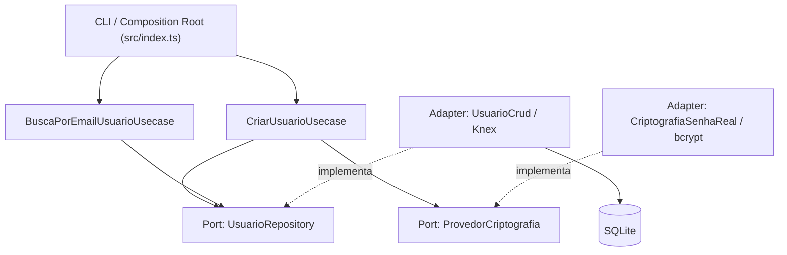
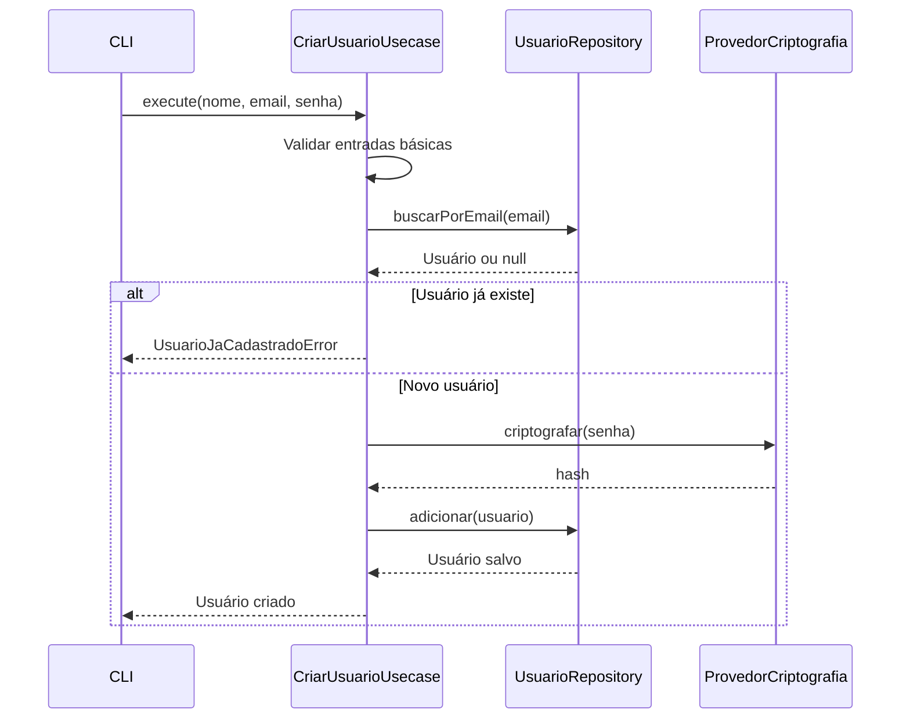

# Arquitetura Hexagonal com TypeScript

Exemplo executável de **Ports & Adapters (Arquitetura Hexagonal)** usando TypeScript, Node.js, Knex, SQLite e bcrypt.

O projeto demonstra como implementar casos de uso que dependem de **contratos do núcleo**, em vez de dependerem diretamente de banco de dados ou bibliotecas externas. É um laboratório de arquitetura de software, **não** uma API HTTP nem um sistema de autenticação completo.

## O que o projeto demonstra

- Cadastro e busca de usuários por e-mail.
- Rejeição de e-mails duplicados e validação básica de entradas.
- Hash de senha usando o adapter real de bcrypt.
- Persistência SQLite atrás de uma porta tipada.
- Testes unitários independentes de infraestrutura e testes de integração com SQLite temporário.
- Compilação, testes, execução da demonstração e auditoria de dependências no GitHub Actions.

## Executar

**Requisitos:** Node.js 24 e npm. O `better-sqlite3` utiliza módulo nativo; ferramentas de compilação podem ser necessárias em algumas plataformas.

```bash
npm ci
npm run demo
```

O comando `demo` compila o TypeScript, executa as migrations, cria um usuário fictício com e-mail aleatório e depois o consulta. A saída contém apenas **ID, nome e e-mail**, nunca senha nem hash. O banco fica em `src/exemplo/adapters/db/knex/banco.sqlite3` e é ignorado pelo Git.

Para utilizar outro arquivo de banco em um diretório existente (Linux/macOS):

```bash
SQLITE_DB_PATH=/tmp/hexagonal-demo.sqlite3 npm run demo
```

Outros comandos:

```bash
npm run build
npm test -- --runInBand --ci
npm run migration:up
npm run migration:down
npm audit --audit-level=high
```

O comando `npm run dev` inicia a demonstração através de `ts-node-dev`; não inicia um servidor HTTP.

## Arquitetura



**Regra de dependência:** os casos de uso conhecem somente `UsuarioRepository`, `ProvedorCriptografia` e `UsuarioModel`. O código do núcleo não importa Knex, SQLite ou bcrypt. O `src/index.ts` é o *composition root*, responsável por escolher e conectar implementações concretas.

| Área | Responsabilidade | Local |
| --- | --- | --- |
| Domínio / casos de uso | Regras de criação e consulta de usuários | `src/exemplo/appcore/domain/` |
| Portas | Contratos tipados exigidos pelos casos de uso | `src/exemplo/appcore/ports/` |
| Adapters | Implementações de persistência e hash | `src/exemplo/adapters/` |
| Composição | Configuração e execução do fluxo | `src/index.ts` |
| Testes | Regras sem banco e integração com SQLite | `test/` |

### Exemplo de inversão de dependências

```typescript
interface UsuarioRepository {
  adicionar(usuario: UsuarioModel): Promise<UsuarioModel>;
  buscarPorEmail(email: string): Promise<UsuarioModel | null>;
}
```

O caso de uso solicita `buscarPorEmail(email)`, sem montar SQL ou conhecer nomes de colunas. O adapter `UsuarioCrud` implementa a consulta com Knex.

### Fluxo de cadastro



O exemplo usa uma implementação de criptografia que inverte a string **somente para testes e ilustração**. O fluxo executável utiliza `CriptografiaSenhaReal` com bcrypt.

## Testes e integração contínua

```bash
npm test -- --runInBand --ci
```

Os testes são organizados em duas categorias:

- **Unitários:** usam implementações simuladas das portas e verificam validações, duplicidade, persistência, busca e propagação de erros, sem inicializar SQLite.
- **Integração:** usam SQLite temporário, aplicam as migrations e verificam os adapters e os casos de uso contra persistência real.

O workflow `.github/workflows/quality.yml` executa `npm ci`, build TypeScript, testes Jest, demonstração CLI com banco descartável e `npm audit --audit-level=high`.

## Decisões e limitações

- **Escolha de SQLite:** reduz o custo de executar e compreender o exemplo. Não há infraestrutura distribuída, filas ou microsserviços.
- **Contratos orientados ao domínio:** a porta `UsuarioRepository` evita expor nomes de campos de banco ao núcleo.
- **Validação de entrada:** confere nome e senha não vazios e formato básico de e-mail. Não constitui validação completa de identidade ou política robusta de senhas.
- **Cadastro de e-mail duplicado:** há verificação no caso de uso e restrição `unique` no esquema. Concorrência e tratamento específico de violação do banco ainda podem evoluir.
- **Senha:** o modelo armazena o hash, mas o exemplo não possui autenticação/login, autorização ou gerenciamento de sessão.
- **Segurança das dependências:** na última auditoria de novembro de 2026, não foram encontrados alertas **altos/críticos**, porém permaneceram **16 moderados e 4 baixos**, acompanhados na [Issue #2](https://github.com/danmaciel/arquitetura_hexagonal/issues/2).
- **Banco em histórico:** um arquivo SQLite anteriormente versionado foi retirado da versão atual. Isso não apaga os commits antigos; seu conteúdo histórico ainda precisa de revisão.

## Referências

- [Alistair Cockburn — Hexagonal Architecture](https://alistair.cockburn.us/hexagonal-architecture/)
- [Robert C. Martin — The Clean Architecture](https://blog.cleancoder.com/uncle-bob/2012/08/13/the-clean-architecture.html)
- [Knex.js](https://knexjs.org/)

## Licença

Consulte [LICENSE](LICENSE).
