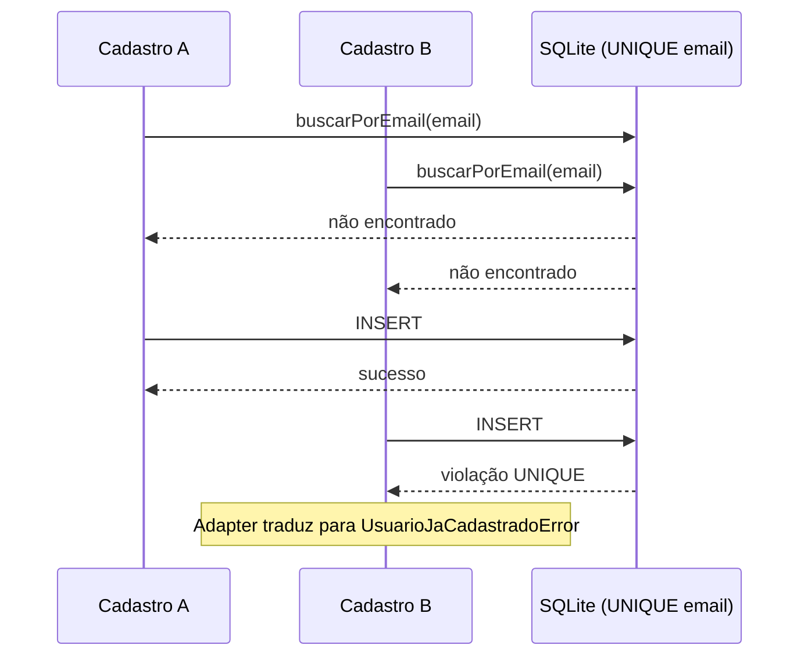

# ADR 0001 — Garantir unicidade de e-mail na persistência

- **Status:** Aceita
- **Data:** 2026-11-06
- **Contexto:** Exemplo educacional de arquitetura hexagonal com TypeScript, Knex e SQLite.

## Problema

O caso de uso consulta previamente se um e-mail já existe. Em acessos concorrentes,
duas tentativas podem receber "não encontrado" antes de qualquer inserção.
Portanto, a consulta prévia melhora a experiência, mas não garante unicidade.

## Decisão

1. Normalizar o e-mail com `trim().toLowerCase()` antes de cadastrar ou consultar.
2. Manter a restrição `UNIQUE` da coluna `usuarios.email` na migration.
3. No adapter SQLite, traduzir especificamente a violação de unicidade em
   `usuarios.email` para `UsuarioJaCadastradoError`.
4. Propagar outras falhas de persistência sem mascará-las.
5. Testar a tradução usando SQLite real, além dos testes unitários do caso de uso.

## Fluxo

O diagrama apresenta um interleaving possível. O teste de integração do PR #8 utiliza duas conexões independentes ao mesmo arquivo SQLite e inicia as inserções como promessas concorrentes após ambas as consultas retornarem vazio; não garante sobreposição física dos writes, pois o SQLite serializa as escritas.

## Consequências e limites

- A integridade não depende apenas do resultado de uma consulta anterior.
- O núcleo continua desacoplado dos códigos de erro específicos do SQLite.
- O adapter passa a conhecer a restrição e sua representação de erro no driver.
- O uso de `toLowerCase()` para o e-mail inteiro é uma convenção simplificada
  deste laboratório; não cobre todas as particularidades de endereços de e-mail.
- Registros históricos não normalizados exigiriam migração antes de aplicar a
  mesma política em um sistema existente.
- Os testes sequenciais verificam a tradução de erro pelo adapter. Um teste separado em `test/ConcorrenciaUsuarios.test.ts` verifica duas conexões independentes, leituras iniciais sem usuário e duas tentativas de inserção disparadas juntas: apenas uma persiste e a outra recebe a violação UNIQUE.
- Esse teste não simula requisições HTTP, threads/processos distintos, carga elevada, transações longas ou bloqueios de escrita. Não demonstra paralelismo real entre operações síncronas do driver; demonstra a integridade da restrição para duas conexões independentes.
- Este projeto não implementa uma API HTTP, autenticação ou uma solução
  distribuída de concorrência.
